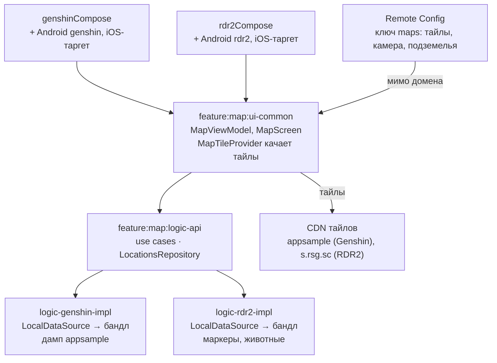
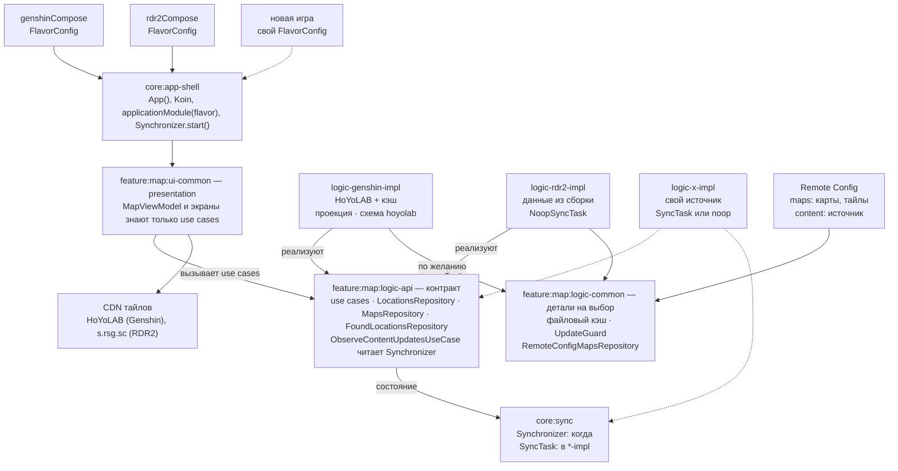

# Архитектура карт: локальные данные и remote API

10 ноября 2026 · Dmitry Voronov

## Контекст и принципы

Все приложения функционально одинаковы, и контракт между логикой и данными задаёт домен. У каждого приложения своя реализация слоя данных: из сборки, из своего JSON или из чужого API.

- **Было:** оба приложения читали маркеры и каталог только из ресурсов сборки. Карты и тайлы приходили из Firebase Remote Config (ключ `maps`) прямо в ViewModel, мимо домена.
- **Genshin** переехал с appsample на официальный API HoYoLAB. Его данные нельзя класть в сборку и в публичный репозиторий, поэтому они грузятся во время работы и кэшируются на устройстве.
- **Новые игры** — вне этого документа. Архитектура должна позволять добавить игру без правок общего кода.

Принципы:

1. Контракт задаёт домен: use cases и интерфейсы репозиториев в `logic-api`. Логика одна на все приложения.
2. Новая функция появляется во всех приложениях сразу: новый use case и, если нужно, метод репозитория, который реализует каждый `logic-<игра>-impl`.
3. Если у игры нет данных для функции, её `logic-<игра>-impl` отдаёт заглушку, а presentation этого флейвора функцию выключает.
4. Откуда приходят данные и как хранятся — деталь реализации `logic-<игра>-impl`, а не часть контракта. Общие детали лежат в `logic-common` и берутся по желанию.
5. Загрузку и актуализацию данных ведёт `core:sync`. Его контракт одинаков для всех приложений, а `SyncTask` реализует `logic-<игра>-impl`.
6. После первой загрузки карта работает без сети. При поломке API показывается последний удачный кэш, а не пустая карта.
7. Адреса и параметры API живут в Remote Config, чтобы чинить их без релиза.

Не менялись: экран карты, платформенные `MapScreen` на Android и iOS, отметки найденных маркеров.

## Архитектура до



Маркеры и каталог каждый флейвор читал из своего бандла через `logic-*-impl`, а `MapViewModel` брал карты и тайлы прямо из Remote Config. Что мешало масштабированию:

- Не было удалённого источника маркеров и кэша: любая правка данных — это релиз.
- Карты шли мимо домена, поэтому источник не мог сообщить актуальную версию тайлов.
- Схемы тайлов были зашиты в `when` внутри `MapTileProvider` и в enum `TileScheme` в `core:remoteconfig`.
- `LocationsRepository` отдавал данные один раз и не умел сообщить об ошибке или обновлении.
- Оболочки `genshinCompose` и `rdr2Compose` почти полностью дублировали друг друга.

## Целевая архитектура



Presentation и данные зависят от домена, а не друг от друга. Каждый `logic-<игра>-impl` реализует репозитории домена по-своему и по желанию берёт готовые детали из `logic-common`. Слот «новая игра» показывает, что добавляется при расширении.

| Модуль | Было | Стало |
| --- | --- | --- |
| `core:app-shell` | — | общие `App()`, Koin и `applicationModule(flavor)`; запускает `Synchronizer` |
| `genshinCompose`, `rdr2Compose` | почти полные копии | `FlavorConfig`: тема, стиль карты, модуль логики, юридическая строка |
| `ui-genshin-impl`, `ui-rdr2-impl` | один `MapStyle` | удалены, всё ушло в `FlavorConfig` |
| `feature:map:ui-common` | карты напрямую из Remote Config | только use cases |
| `feature:map:ui-api` | `when` по схемам тайлов | реестр `TileUrlResolver` |
| `feature:map:logic-api` | `LocationsRepository`, `FoundLocationsRepository` | + `MapsRepository`, `GameMap`, `ObserveContentUpdatesUseCase`, `TileUrlResolver` |
| `core:sync` | — | `Synchronizer`, `SyncTask`, `NoopSyncTask`, платформенные события возврата из фона |
| `feature:map:logic-common` | — | файловый кэш, `UpdateGuard`, `RemoteConfigMapsRepository` |
| `logic-genshin-impl` | бандл appsample | репозитории и `HoyolabSyncTask` на HoYoLAB + кэш |
| `logic-rdr2-impl` | `LocalDataSource` | репозитории на данных сборки, `NoopSyncTask` |
| `core:remoteconfig` | парсил ключ `maps` | отдаёт значения по ключам; `maps` читает домен, `content` — модуль игры |

## Контракт домена и реализации данных

Контракт — это интерфейсы репозиториев в `logic-api`, и их форму задают use cases. Каждый `logic-<игра>-impl` реализует все репозитории домена, и приложение без какого-то метода просто не соберётся. Слой называется `logic`, потому что в него входят и домен, и данные: фичи делят между собой логику через `logic-api`, а данные у каждой игры свои.

| Репозиторий домена | Что даёт логике |
| --- | --- |
| `LocationsRepository` | маркеры и каталог на нужном языке |
| `FoundLocationsRepository` | отметки «найдено», общий на Room |
| `MapsRepository` | карты: тайлы, камера, подземелья, версия тайлов |

```kotlin
// logic-api
interface MapsRepository {
    fun maps(): Flow<MapsConfig>
}
```

Use cases, которые добавились: `GetMapsUseCase` (карты с названиями из каталога) и `ObserveContentUpdatesUseCase` (синхронизация применила обновление, экран перечитывает маркеры и группы). `GameMap` переехал из `core:remoteconfig` в домен, а Remote Config остался одним из способов его получить.

Когда у игры не хватает данных для функции:

1. Модуль данных выполняет контракт заглушкой: пустой список, пустое описание, noop.
2. Presentation флейвора выключает функцию.

Например, RDR2 привязывает `NoopSyncTask`: данные всегда есть, синхронизация ничего не делает, экраны загрузки и обновления не появляются. А описаний точек у Genshin пока нет: `logic-genshin-impl` отдаёт пустые описания, и карточка их не показывает.

Внутри `logic-<игра>-impl` устройство свободное. Хранилище, источник и `SyncTask` — детали реализации, у каждой игры свои:

| Игра | Где хранятся данные | `SyncTask` | Свой код |
| --- | --- | --- | --- |
| RDR2 | в сборке | `NoopSyncTask` | слияние животных с каталогом, как раньше |
| Genshin | файлы в хранилище приложения | `HoyolabSyncTask` | адаптер HoYoLAB, схема тайлов `hoyolab` |

### Адаптер HoYoLAB

1. Ходит по эндпоинтам из Remote Config (`content.baseUrl`): `v3/map/info`, `v2/map/label/tree`, `v3/map/point/list`, `v2/map/point_group`, `v1/map/get_point_changelog`.
2. Переводит метки в `MarkerCategory`, точки в `MapLocation`, а пиксели от `origin` — в координаты приложения через `HoyolabProjection`: сетка тайлов карты лежит в середине мира на зуме 15, поэтому её тайлы совпадают с тайлами карты приложения на этом и всех меньших зумах.
3. Переводит подземелья: `point_group` отдаёт группы этажей с оверлеем (картинка и границы в пикселях), `entrance_ids` и `point_ids`, а у точек есть `point_group` с `group_id` и `floor_id`. Это один к одному `MapDungeon`, `MapFloor` и `LocationDungeon`, поэтому подземелья Genshin приходят из источника, а не из Remote Config.
4. Собирает пины: наш векторный пин из сборки и картинка категории HoYoLAB по URL через `MarkerPin.pictogram`.
5. Подставляет актуальный `map_version` в шаблон тайлов, чтобы после патча тайлы обновлялись без правки Remote Config.

| Что проверено 10 ноября | Результат |
| --- | --- |
| Подземелья Тейвата в `point_group` | 210 групп; в старом конфиге appsample — 196 подземелий и 290 этажей |
| Точки | 96 311 на 7 картах, 11 204 из них в подземельях |
| Changelog | один на все карты, какую бы карту ни спросить |
| Описания и скриншоты точек (`/v1/map/point/info`) | пишут пользователи HoYoLAB: `content`, `img`, `video` с `author_name`; в выборке из 25 точек текст у 3, скриншот у 5. Пока не берём |

### Remote Config и тайлы

Рядом с `maps` появился ключ `content` с параметрами источника. Его читает только модуль данных (`config/remote_config/genshin_content.json`):

```json
{
  "enabled": true,
  "baseUrl": "https://sg-public-api-static.hoyolab.com/common/map_user/ys_obc",
  "params": { "app_sn": "ys_obc" },
  "mapIds": [2, 7, 9, 34, 36, 37, 40],
  "fullRefreshDays": 7
}
```

`MapTiles.scheme` — строка, а не enum: схему ищет реестр `TileUrlResolver` в DI, и модуль игры добавляет свою, не трогая общий код. У HoYoLAB схема `hoyolab`: шаблон `{{x}}_{{y}}_{{level}}` с уровнями `P0` на зуме 15 и `N1`…`N4` ниже, размер сетки и нижний уровень в `MapTiles.params`.

## Синхронизация данных

Загрузку и актуализацию данных ведёт `core:sync`: он решает, когда синхронизироваться. Что скачать и как сохранить, решает модуль данных приложения через `SyncTask`. Домен о синхронизации не знает и только узнаёт о применённых обновлениях.

| Слой | Отвечает за | Одинаков для всех |
| --- | --- | --- |
| `core:sync` | **когда**: запуск, возврат из фона, триггеры задачи, одна синхронизация за раз, минимальный интервал | да |
| `logic-<игра>-impl` | **что и как**: источник, проверка ответа, формат хранения, перевод в доменные модели | нет |
| домен (`logic-api`) | **только чтение**: перечитать данные после обновления | да |
| оболочка (`core:app-shell`) | **что видно**: заглушка без данных, всплывашка во время обновления | да |

```kotlin
// core:sync
interface SyncTask {
    /** Версия данных на устройстве, null — данных ещё нет. */
    suspend fun localVersion(): String?
    /** Дешёвая проверка: есть ли что скачивать. */
    suspend fun check(): SyncCheck                     // UpToDate | UpdateAvailable(remoteVersion, payload)
    /** Скачать, проверить и сохранить; прогресс от 0 до 1 или null. */
    suspend fun update(check: SyncCheck.UpdateAvailable, progress: (Float?) -> Unit): SyncOutcome
    /** Свои поводы синхронизироваться, например смена языка. */
    val triggers: Flow<Unit> get() = emptyFlow()
}

object NoopSyncTask : SyncTask   // localVersion = "bundle", check = UpToDate

data class SyncState(
    val hasLocalData: Boolean?,   // null — ещё не проверили
    val phase: SyncPhase,         // Idle, Checking, Updating(progress), Failed(reason)
    val updates: Int,             // сколько обновлений применено с запуска
)

interface Synchronizer {
    val state: StateFlow<SyncState>
    fun start()
    fun syncNow(force: Boolean = false)
}
```

Каждое приложение привязывает свою реализацию через DI:

```kotlin
// logic-genshin-impl
single<SyncTask> { HoyolabSyncTask(get(), get(), get(), get()) }
// logic-rdr2-impl
single<SyncTask> { NoopSyncTask }
// core:sync
single<Synchronizer> { DefaultSynchronizer(task = get(), foregroundEvents = get(), crashReporter = get()) }
```

Как проходит синхронизация:

1. `Application.onCreate` на Android и `iOSApp.init` на iOS сразу после старта Koin вызывают `Synchronizer.start()`. Синхронизатор сразу читает `localVersion()` и публикует `hasLocalData`.
2. Поводы синхронизироваться: запуск и каждый возврат из фона (`ProcessLifecycleOwner` на Android, `UIApplicationWillEnterForegroundNotification` на iOS) и `triggers` задачи. Одновременно идёт одна синхронизация, запросы во время неё выполняются один раз после.
3. Фаза `Checking`: `check()`. У HoYoLAB это changelog и версии тайлов, несколько килобайт. На экране ничего не показывается.
4. Фаза `Updating`: `update()` с прогрессом. Реализация скачивает данные, проверяет их через `UpdateGuard` и сохраняет. Потом `updates` растёт, и домен через `ObserveContentUpdatesUseCase` перечитывает маркеры и группы.
5. При ошибке — `Failed`. Сетевые ошибки уходят только в лог, остальные и отклонённые обновления — non-fatal в Crashlytics.

### Что видит пользователь

Экран загрузки и всплывашку рисует оболочка (`SyncedContent` в `core:app-shell`) по `Synchronizer.state`:

| Данные на устройстве | Фаза | Экран |
| --- | --- | --- |
| неизвестно | любая | системный сплэш держится (`setKeepOnScreenCondition` на Android) |
| нет | `Checking`, `Updating` | заглушка: иконка сплэша, «Загружаем карту…», прогрессбар |
| нет | `Failed` | заглушка с ошибкой и кнопкой «Повторить» (`syncNow(force = true)`) |
| есть | `Idle`, `Checking` | обычный экран |
| есть | `Updating` | обычный экран + всплывашка «Обновляем карту» с прогрессом |
| есть | `Failed` | обычный экран, данные остаются прежними |

- Всплывашка появляется через 300 мс и держится минимум 1 с, после успеха показывает «Карта обновлена» 1,5 с. Нажатие скрывает её, обновление идёт дальше.
- Дизайн задаёт каждая игра в своём `core:ui-<игра>`: `ProgressIndicatorComponent` (золотая полоса у Genshin, красный мазок кисти у RDR2), `PanelComponent` всплывашки, цвета и типографика темы и `GameMapStyle.appIcon()` — та же иконка, что на сплэше, на том же месте.

Подробности:

- Смену языка объявляет `HoyolabSyncTask` в `triggers`: названия категорий HoYoLAB приходят на нужном языке, до их загрузки показываются уже скачанные. Core о языке не знает.
- `UpdateGuard` в `logic-common` хранит общие правила: не заменять данные пустым ответом или ответом, где точек вдвое меньше. Реализации `SyncTask` вызывают его явно.
- Раз в `fullRefreshDays` дней `HoyolabSyncTask` скачивает всё заново, даже если changelog молчит: он может не сообщать об удалённых точках.
- Фоновые задачи (WorkManager, BGTaskScheduler) пока не нужны. Если понадобятся, станут ещё одним триггером внутри `core:sync`.
- Синхронизацию стоит провести через домен, только если обновление станет логикой продукта: показ «что нового», подтверждение, выбор карт для скачивания.

## Кэш, офлайн и ошибки

Карта сразу открывается из файлов последнего обновления, а источник опрашивается в фоне. Плохой ответ источника никогда не затирает хорошие данные.

| Уровень | Что хранит | Где |
| --- | --- | --- |
| Память | прочитанное из файлов, сбрасывается по ревизии после каждого сохранения | `GenshinContent` |
| Диск | точки в колоночном формате (около 3 МБ вместо 22,5 МБ ответа), названия по языкам, мета с версией | `ContentFileStore`: `filesDir/content` на Android, Application Support на iOS |
| HTTP-кэш | тайлы и иконки | не сделан |

- Запись атомарная: временный файл и замена одним шагом. Мета пишется последней, поэтому после сбоя записи следующий запуск просто проверит источник заново.
- Проверка ответа перед записью — `UpdateGuard`: не пусто и не меньше половины точек, что были.
- `content.enabled = false` в Remote Config останавливает запросы к источнику, и приложение работает на сохранённых данных.

## Как добавить новую игру

Конкретные игры вне этого документа; раздел описывает, что должно оставаться верным, чтобы игра добавлялась без правок общего кода. Игра — это три собственных модуля и настройки вне кода. Общие модули (`ui-common`, `logic-api`, `logic-common`, `core:*`) не меняются.

```kotlin
val genshinFlavor = FlavorConfig(
    privacyPolicyUrl = "https://onthecrow.github.io/interactive-game-map/genshin/privacy-policy/",
    mapStyle = MapStyle(backgroundColor = Color(0xFF000000)),
    uiModule = genshinUiModule,       // core:ui-genshin
    logicModule = mapLogicModule,     // feature:map:logic-genshin-impl
    legalNotice = listOf("© All rights reserved by COGNOSPHERE. …"),
)
```

Чек-лист новой игры:

- [ ] **Тема** `core:ui-<игра>`: цвета, шрифты, панели, кнопки, прогрессбар, иконка сплэша — по образцу `core:ui-rdr2`. Шрифты с открытой лицензией, лицензии в `licenses`.
- [ ] **Логика** `feature:map:logic-<игра>-impl`: реализации всех репозиториев домена и `SyncTask` (для офлайн-игры — `NoopSyncTask`). Из `logic-common` — по желанию. Данных для какой-то функции нет — заглушка.
- [ ] **Оболочка** `<игра>Compose` с `FlavorConfig`, Android-модуль (applicationId, иконки, splash, старт синхронизатора в `Application`) и iOS-таргет со своим каталогом иконок.
- [ ] **Firebase**: приложения Android и iOS, `google-services.json` и `GoogleService-Info.plist`, Remote Config `maps` и, для онлайн-игры, `content`.
- [ ] **Тайлы**: источник и схема. Подходит существующая схема — кода не нужно, иначе свой `TileUrlResolver` в `logic-<игра>-impl`.
- [ ] **Права**: своё название без товарного знака (как MapSlinger), правила правообладателя для фан-контента, страница privacy policy.
- [ ] **Сторы**: описание, скриншоты, дисклеймер о неофициальном приложении.

## Статус миграции Genshin

На 10 ноября 2026, ветка `feature/genshin-hoyolab`:

1. **Карты через домен** — сделано.
2. **`core:sync`** — сделано, 8 тестов синхронизатора.
3. **Детали в `logic-common`** — сделано: файловое хранилище, `UpdateGuard`, `RemoteConfigMapsRepository`, с тестами.
4. **Схемы тайлов** — сделано: `centered`, `xyz`, `hoyolab`.
5. **HTTP-кэш** тайлов и иконок — **не сделано**.
6. **Genshin на HoYoLAB** — сделано. Новые `config/remote_config/genshin_maps.json` и `genshin_content.json` нужно опубликовать в Firebase: до этого старый `maps` указывает на тайлы appsample, и новые точки встанут не на свои места.
7. **Presentation** — сделано: заглушка, всплывашка, стиль каждой игры, строки на 9 языках.
8. **Удаление appsample** — сделано в текущей версии; история git не чищена.
9. **Юридическое** — строка © COGNOSPHERE и пометка о неофициальном приложении в настройках; новое название — не выбрано.
10. **Проверка** — iOS-симулятор: первый запуск с заглушкой, загрузка, всплывашка обновления, смена языка. Android — сборка и тесты.

## Риски и открытые вопросы

Главный риск — неописанный API HoYoLAB: он может поменяться в любой день. Кэш, проверки и адреса в Remote Config сделаны именно под это. Genshin ещё не в сторах, поэтому совместимость со старыми сборками и отметками не нужна.

| Риск | Что случится | Что делаем |
| --- | --- | --- |
| HoYoLAB меняет формат или адреса | новые данные не загружаются | последний кэш, non-fatal в Crashlytics, правка `content` в Remote Config или релиз адаптера |
| HoYoverse закрывает доступ или просит прекратить | нет новых данных, тайлы пропадают | `content.enabled = false`, не обходим блокировку |
| 22,5 МБ JSON точек на слабом телефоне | долгий первый запуск | разбор вне главного потока, колоночный формат на диске |

Решено 10 ноября:

- Genshin ещё не в сторах — делаем без обратной совместимости.
- Описания и скриншоты точек HoYoLAB пишут пользователи — пока не берём.
- Подземелья HoYoLAB ложатся на нашу модель — берём из `point_group`.
- Новые игры — вне этого документа; держим кодовую базу расширяемой.
- Имена `logic-*` остаются: слой включает домен и данные, а фичи делят логику через `logic-api`.

Открытые вопросы:

- [ ] Что значат `z_level` (0–3, не ноль у 457 точек) и `icon_sign` (0–3) у точек HoYoLAB. Похоже на значки этажа и высоты на пине.
- [ ] Шрифт Genshin обрезан до GB2312, Shift_JIS и Хангыля: 7 редких иероглифов в китайских и 1 в японских названиях HoYoLAB рисуются системным шрифтом.

Источники: [официальная карта HoYoLAB](https://act.hoyolab.com/ys/app/interactive-map/index.html?lang=en-us), [HoYoLAB Legal FAQ](https://www.hoyolab.com/article/143107), [Genshin Impact Terms of Service](https://genshin.hoyoverse.com/en/company/terms).
